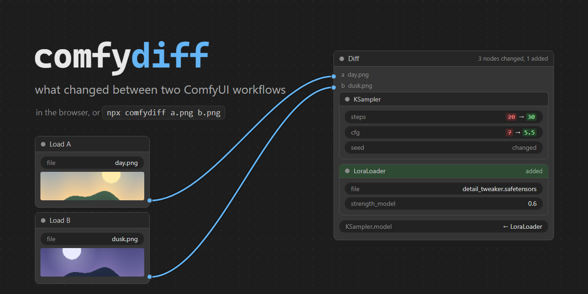
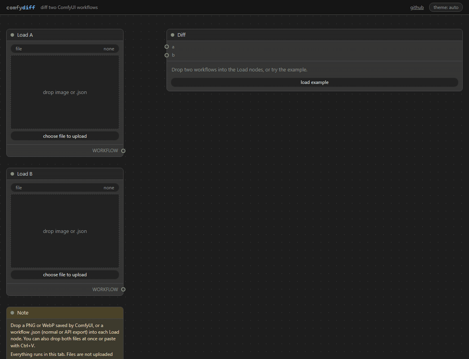
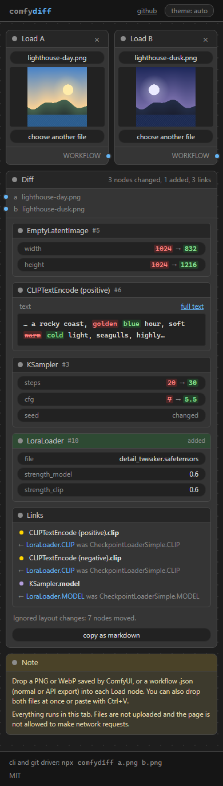

<p align="center"></p>

Compare two ComfyUI workflows and see what actually changed: settings, prompts, added or removed nodes, rewired inputs. Moved nodes and other layout noise are left out.

**Web version: https://safdafang.github.io/comfydiff/** ([with an example loaded](https://safdafang.github.io/comfydiff/#example))

<p align="center"></p>

```text
  EmptyLatentImage:          width 1024 → 832, height 1024 → 1216
  CLIPTextEncode (positive):
    text: … rocky coast, [-golden-]{+blue+} hour, soft [-warm-]{+cold+} light, seagulls,…
  KSampler:                  steps 20 → 30, cfg 7 → 5.5, seed changed
+ added:                     LoraLoader (detail_tweaker.safetensors, strength_model 0.6, strength_clip 0.6)
~ rewired:                   KSampler.model now from LoraLoader.MODEL, not CheckpointLoaderSimple.MODEL
(ignored layout changes: 7 nodes moved)
```

## Why

Every image saved by ComfyUI carries its workflow, so "why does this one look better?" has an answer. Finding it by clicking through two graphs is slow, and `git diff` on workflow JSON is useless because dragging one node rewrites half the file.

## What it does

- Reads PNG and WebP saved by ComfyUI, and workflow JSON in both formats (the normal save and "Export (API)"). The format is detected automatically, and you can compare a PNG against a JSON.
- Lists changed settings per node first, then added and removed nodes, then links ("`KSampler.model` now from LoraLoader"), then bypassed or muted nodes. Layout changes are counted in one line at the end.
- Shows a seed change as a short note, since the seed changes on almost every run.
- Diffs long prompts word by word and highlights only the changed parts.
- Matches nodes even when the workflow was rebuilt and node ids changed.
- Says "no differences that affect the output" when there are none.
- Copies the result as Markdown for Discord, Reddit or GitHub.

Editor-format JSON stores widget values without names. comfydiff takes names from the API prompt in the same or the other file, from the widget metadata newer ComfyUI versions write, or from a small table of core nodes. If none of these fit exactly, it shows `param #3: 20 → 30` instead of guessing.

## Privacy

The page reads your files in your browser. Nothing is uploaded, and there is no server, account, analytics or cookies.

The built page has a Content-Security-Policy with `connect-src 'none'`, so the browser itself blocks any network request from it (fetch, WebSocket, beacons, remote images). The example is bundled into the page, so loading it makes no request either.

The CLI only reads the files you give it.

<p align="center"></p>

## CLI

Node.js 18 or newer.

```sh
npx comfydiff before.png after.png        # colored report
npx comfydiff a.json b.json --markdown    # for Discord or GitHub
npx comfydiff a.png b.json --json         # machine readable
```

Exit code `0` means no differences that affect the output, `1` means there are some, `2` is an error (missing file, image without a workflow and so on). Colors are on in a terminal; use `--no-color` or `NO_COLOR` to turn them off.

## git

`comfydiff textconv` prints a stable text form of a workflow: nodes in dependency order, named parameters, links as `input <- [id] Node.OUTPUT`, long prompts split one clause per line, no positions. With it, `git diff` shows `-    steps = 20` / `+    steps = 30` instead of a wall of JSON.

`.gitattributes`:

```gitattributes
*.json diff=comfyui
*.png  diff=comfyui
*.webp diff=comfyui
```

Then:

```sh
git config diff.comfyui.textconv "comfydiff textconv"
git config diff.comfyui.cachetextconv true
```

JSON files that are not workflows pass through unchanged, so mapping all `*.json` is safe.

To get the comfydiff report itself inside `git diff`, also set an external diff driver:

```sh
git config diff.comfyui.command "comfydiff git-diff"
```

`git log -p` needs `--ext-diff` to use it.

## How it works

1. Both files are turned into the same graph model: nodes, named parameters, links. Positions, sizes, colors, notes, groups and reroutes are set aside. Links are followed through Reroute, Set/Get nodes, primitive nodes and subgraphs.
2. Nodes are matched by id and type, then by type plus similar settings and neighbours. This runs twice so that look-alike nodes (two LoRA loaders in a chain, positive and negative prompts) end up with the right partner.
3. When one file is in API format, which does not store disabled nodes, the other file is compared in its effective wiring, so a bypassed node does not show up as fake rewiring.

## Formats and limits

| Input | |
| --- | --- |
| PNG from ComfyUI (tEXt, iTXt, zTXt chunks) | yes |
| Workflow JSON, editor format, schema 0.4 and 1, subgraphs | yes |
| Workflow JSON, API format, `/prompt` request bodies | yes |
| WebP from ComfyUI (EXIF) | yes |
| JPEG with the same EXIF tags | partial |
| AVIF, MP4, WebM | no |
| Images re-saved by Discord, Telegram, Reddit, X | no, they strip the metadata (the page tells you) |

- Custom nodes in editor-only files show parameters by position. Compare against a PNG or an API export of the same workflow to get names.
- API-format files leave out bypassed and muted nodes, so such a node shows up as removed. The report mentions this.
- Exposed widgets on a subgraph node are not compared on their own; the nodes inside the subgraph are.
- Nodes like "Anything Everywhere" create links only when the prompt is queued, so in editor-only files those links are not visible.
- When ids change and there are many identical nodes with different settings, a node can be reported as removed and added instead of changed.

## Development

```sh
npm install
npm test           # core, CLI bundle, and a real git textconv round trip
npm run typecheck
npm run dev        # web page with hot reload
npm run build      # packages/cli/dist and packages/web/dist
npm run fixtures   # regenerate the test fixtures (Node 22.6+)
```

- `packages/core`: parsing, normalization, matching, diff and output. No DOM or Node APIs.
- `packages/cli`: the `comfydiff` command, bundled into one file without dependencies.
- `packages/web`: the static page, Vite and plain TypeScript.
- `fixtures`: synthetic workflows and images made by `scripts/gen-fixtures.ts`.

## License

[MIT](LICENSE)
